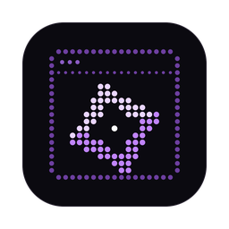
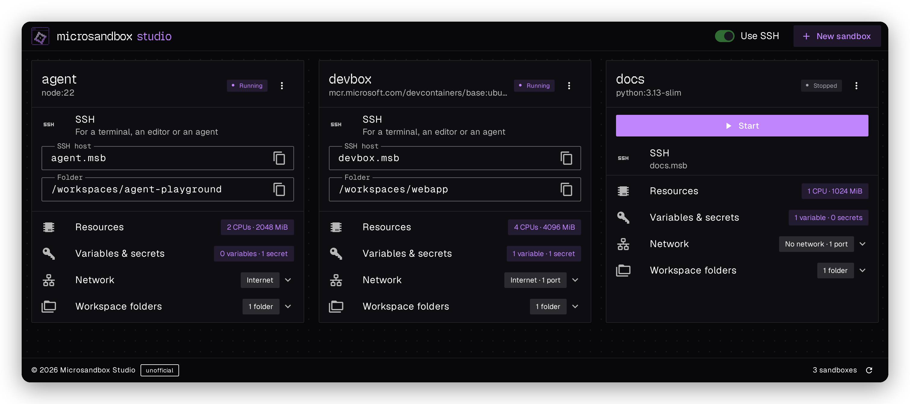
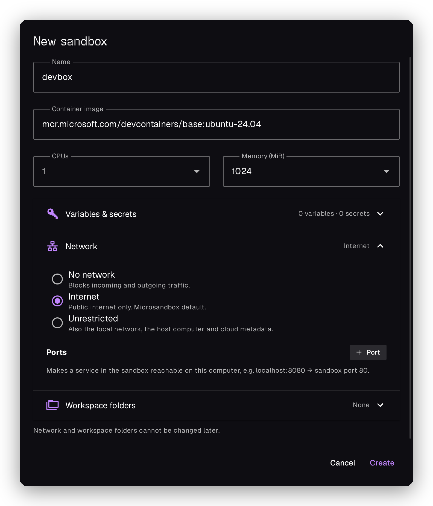

<p align="center">
  
</p>

<h1 align="center">Microsandbox Studio</h1>

<p align="center">
  A simple desktop app for <a href="https://microsandbox.dev">Microsandbox</a>.<br>
</p>



Microsandbox runs small virtual machines on your computer. Microsandbox Studio puts them in one window. Every sandbox is a card. You create, start and stop sandboxes with a click, and you reach any of them over SSH as `<name>.msb`, from a terminal, an editor or Claude Code.

The app does a few things and keeps them simple:

- Create a sandbox from any container image
- Set CPUs, memory, variables and secrets
- Choose the network and publish ports
- Mount folders from your computer
- Open every sandbox over SSH

## Download

Get the installer for your system from the [releases page](https://github.com/bnjgl/microsandbox-studio/releases)

You need macOS on Apple Silicon, Linux with KVM, or Windows with the Windows Hypervisor Platform turned on.

The macOS app is not signed by Apple. On the first start, open it with a right click and **Open**, or allow it under **System Settings > Privacy & Security**.

## Create a sandbox

Click **New sandbox**, give it a name and pick an image. The default image is an Ubuntu development image with Git and curl.

You can add variables and secrets, choose the network and add folders from your computer. Programs in the sandbox only see a placeholder for each secret. Microsandbox puts in the real value on the way to the hosts you allow.

The network and the folders are fixed once the sandbox exists. Everything else can be changed later on its card.

<p align="center">
  
</p>

## Use a sandbox with Claude Code

1. In Microsandbox Studio, turn on **Use SSH** in the top bar. You only do this once, and turning it off undoes it.
2. Add this line at the very top of `~/.ssh/config` (on Windows `C:\Users\<you>\.ssh\config`), above any `Host` or `Match`:

   ```
   Include ~/.microsandbox-studio/ssh_config
   ```

   The app shows the same line until it finds it in the file.
3. Start the sandbox. Its network has to be **Internet**, because Claude Code installs itself in the sandbox on the first connect.
4. In the Claude desktop app, open the environment menu below the prompt box and choose **New environment**.
5. On the **SSH** tab, open **Host** and choose **Add SSH connection**.
6. Enter a name and `<sandbox_name>.msb` as the SSH host, using your sandbox's name. Leave the other fields empty and save.
7. Pick a folder, for example `/workspaces/webapp`, and click **Create environment**.

Programs run as `root`. For another user of the image, write it in front of the host, for example `vscode@devbox.msb`.

On Windows, the Claude app needs Microsoft's OpenSSH client 9.4 or later, and the app has to come from [claude.com](https://claude.com/download), not from the Microsoft Store. See [SSH sessions](https://code.claude.com/docs/en/desktop) in the Claude Code docs.

The same host works everywhere else too, for example `ssh devbox.msb` in a terminal or Remote SSH in VS Code.

## Build it yourself

You need [uv](https://docs.astral.sh/uv/) and [Node.js](https://nodejs.org).

```bash
git clone https://github.com/bnjgl/microsandbox-studio
cd microsandbox-studio
cd frontend
npm ci
npm run build
cd ..
uv run microsandbox-studio
```

On Linux, the window uses GTK. On Ubuntu and Debian, install its parts first:

```bash
sudo apt install libcairo2-dev libgirepository-2.0-dev gir1.2-webkit2-4.1
```

To build the app for your system and start it, run these after the frontend build:

```bash
uvx pip wheel --no-deps proxy_tools -w wheels
uvx briefcase package --adhoc-sign
uvx briefcase run
```

The installer ends up in `dist/`. This works the same on macOS, Linux and Windows.

Run the tests with `uv run pytest` and, in `frontend`, `npm test`.

## License

[Apache-2.0](LICENSE) 
<br>
<br>
Microsandbox is a project of its own team, and this app is not affiliated with it.
